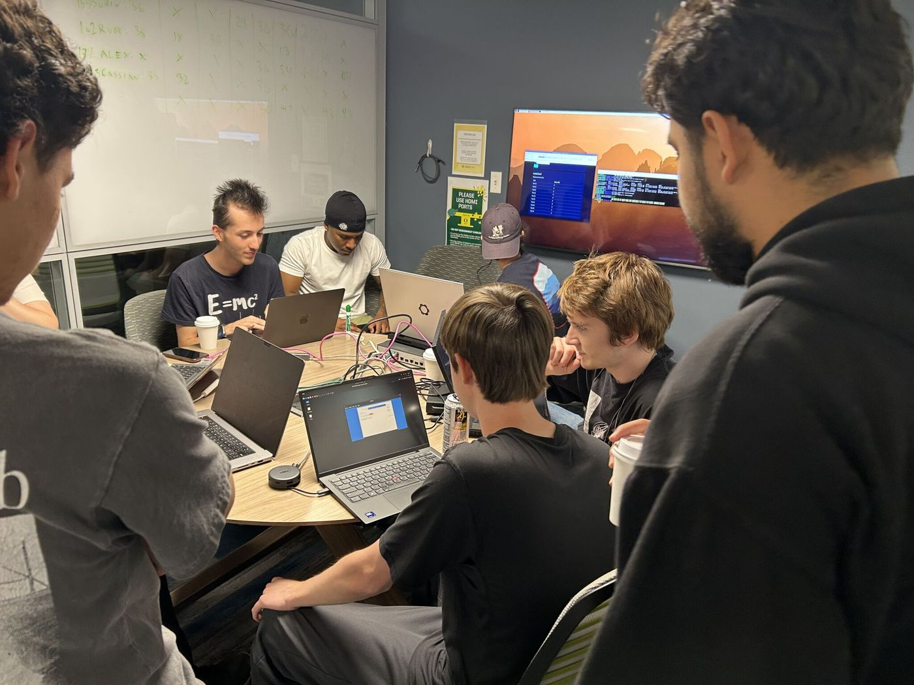

Thursday night's CTF didn't need the internet. The whole thing ran on one Raspberry Pi. Tanner built the network and hosted it with Darwin, who worked with him to troubleshoot it. Laptops connected straight in through cables and a switch. You plugged in, looked around the network, and went hunting for flags. Ethernet adapters were on the table for anyone whose laptop no longer has a port.

For this General Meeting on Thursday, Oct 15, we moved to the DREAM Lab in Knight Library from 6:00–8:00 PM, and about 14 people signed in.

## A CTF you can hold in your hand

A small, closed network like this is a great way to practice. Everything you're attacking sits right there on the table, it belongs to the club, and nothing you do leaves the room. That makes it a safe place to try a scan, poke at a service, and see what happens without worrying about hitting something you shouldn't.

If you want to keep going after a night like this, a home lab is the next step. Our [home lab recap](https://uosec.org/blog/2026/10/03/build-a-home-lab-for-ctfs/){:target="_blank" rel="noopener"} has a six-step checklist to build one.

## Nate's Flipper Zero demo

During the CTF, Nate gave a Flipper Zero demo with a custom Duckyscript. Duckyscript is the scripting language behind "rubber ducky" attacks, where a device plugs in, tells the computer it's a keyboard, and types out commands far faster than any person could. It's a good reason to lock your screen when you walk away and to think twice before plugging in a USB device you didn't buy.

## Stay in bounds

Practice only on systems you own, on labs and CTFs the club provides, or on systems where you have written permission. Do not scan, probe, or access UO systems, classmates' devices, or anyone else's systems without written authorization from the owner. Unauthorized access can violate UO policy and US law. When in doubt, ask leadership and don't proceed.

## More news

- **Facilitator training.** Tuesday's Backdoors and Breaches Workshop on Oct 13 trained our facilitators for the High School Summit.
- **High School Summit, Nov 2.** High school students play Backdoors and Breaches with club facilitators, then pick topic breakouts. Everything you need to know is on the [conference page](https://k12cyber.uoregon.edu/conference/){:target="_blank" rel="noopener"}.

## Come join us

Find us in [the club Discord](https://discord.com/invite/wn4T3byxh4){:target="_blank" rel="noopener"} with questions, and keep an eye on the [calendar](https://uosec.org/calendar.html){:target="_blank" rel="noopener"} for what's happening each week.
