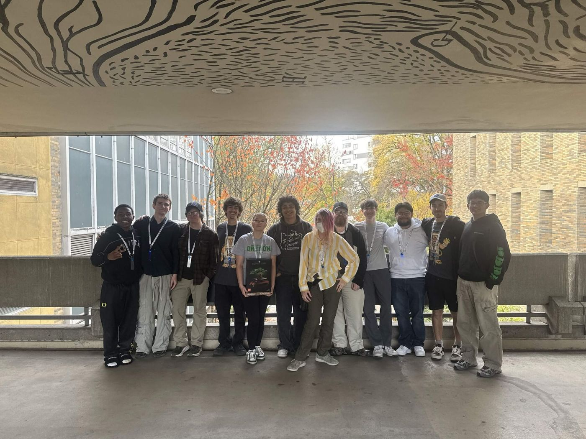
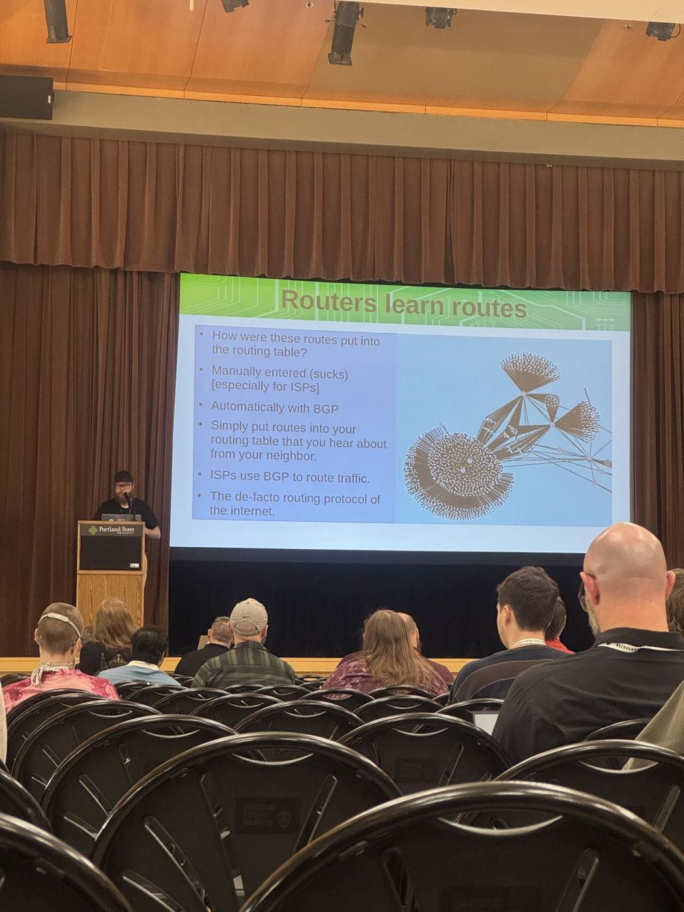

Last weekend, UOSEC took 2nd place in the BSidesPDX CTF. The competition ran for 28 hours, from Friday, Oct 23 to Saturday, Oct 24, and it covered four categories: Web, Rev/Pwn, Social Engineering, and Crypto.

A finish like that is worth more if everyone learns from it, so Thursday's General Meeting on Oct 29 was the debrief.

## Walking through it one category at a time

Justice led the debrief and took the room through the CTF one category at a time, asking the same questions for each: what did we solve, what tool or trick cracked it, and what would we do differently next time.

- **Web.** Finding and exploiting bugs in web apps and the servers behind them, like logins, cookies, and APIs.
- **Rev/Pwn.** Taking compiled programs apart, finding the bug, and then making the program do what you want.
- **Social Engineering.** OSINT and conversation, the human side of security. These skills are for CTFs and authorized work only.
- **Crypto.** Finding the weak spot in how a message was encrypted, then reading it.

If you missed the meeting and want to know how a challenge went, ask the people who worked it in [the club Discord](https://discord.com/invite/wn4T3byxh4){:target="_blank" rel="noopener"}.

## Nate's talk at BSidesPDX

The CTF wasn't the only UOSEC win at BSidesPDX. Nate Balmain gave a talk there, [BGP: A Gateway to Insecure Insanity](https://bsidespdx.org/events/2026/speakers.html#session-KE9T3K){:target="_blank" rel="noopener"}. BGP is the protocol networks use to tell each other how to route traffic across the internet, and it was built on trust. Nate's talk covered how that trust gets exploited, notable nation-state BGP hijacks that hit services like YouTube, Apple, and Telegram, and how people detect and defend against them. It closed with a case study on how exposed university networks are to BGP hijacking, including the University of Oregon.

## The Crypto Escape Room

Crypto was the last category on purpose. It led straight into the Crypto Escape Room, run by Tanner and Adriana, so the night ended with hands-on cipher breaking instead of slides.

## Coming up

- **High School Summit, Mon, Nov 2.** Club facilitators run Backdoors and Breaches for high school students. Details are on the [conference page](https://k12cyber.uoregon.edu/conference/){:target="_blank" rel="noopener"}.
- **Fall Term Summit with Palo Alto Networks, Thu, Nov 12.**
- **Fall Term Conference with Zeina Boulos, Thu, Nov 19.**

Workshops are on Tuesdays and General Meetings are on Thursdays, and everyone is welcome.

## Come join us

Find us in [the club Discord](https://discord.com/invite/wn4T3byxh4){:target="_blank" rel="noopener"} with questions, and keep an eye on the [calendar](https://uosec.org/calendar.html){:target="_blank" rel="noopener"} for what's happening each week.
