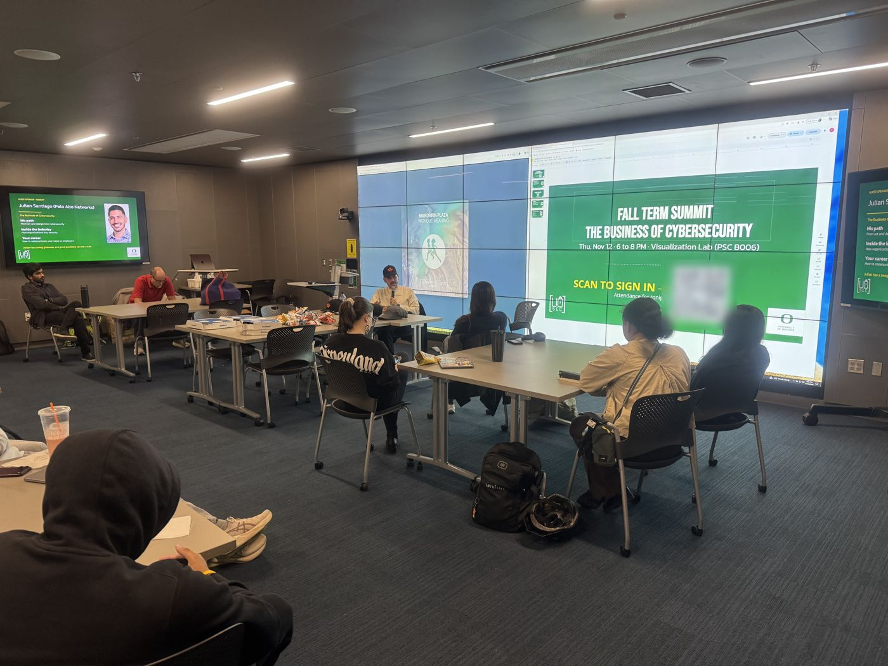
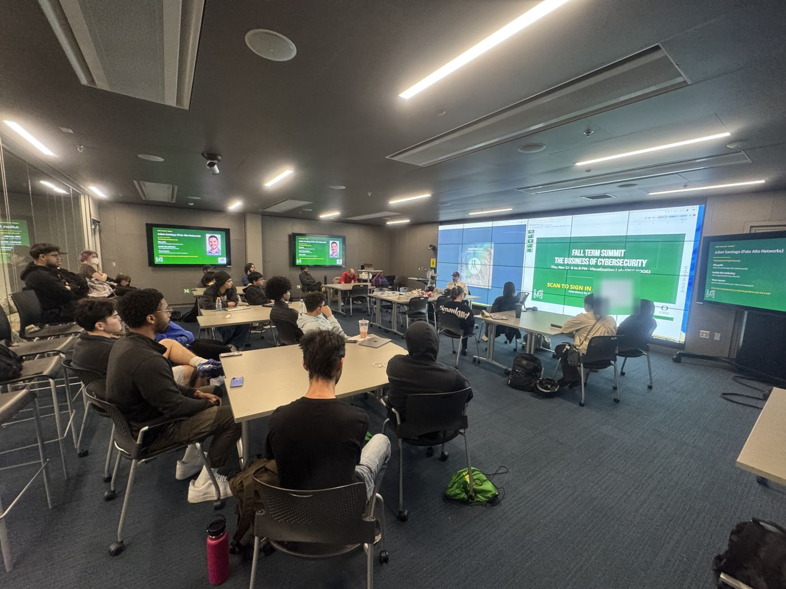
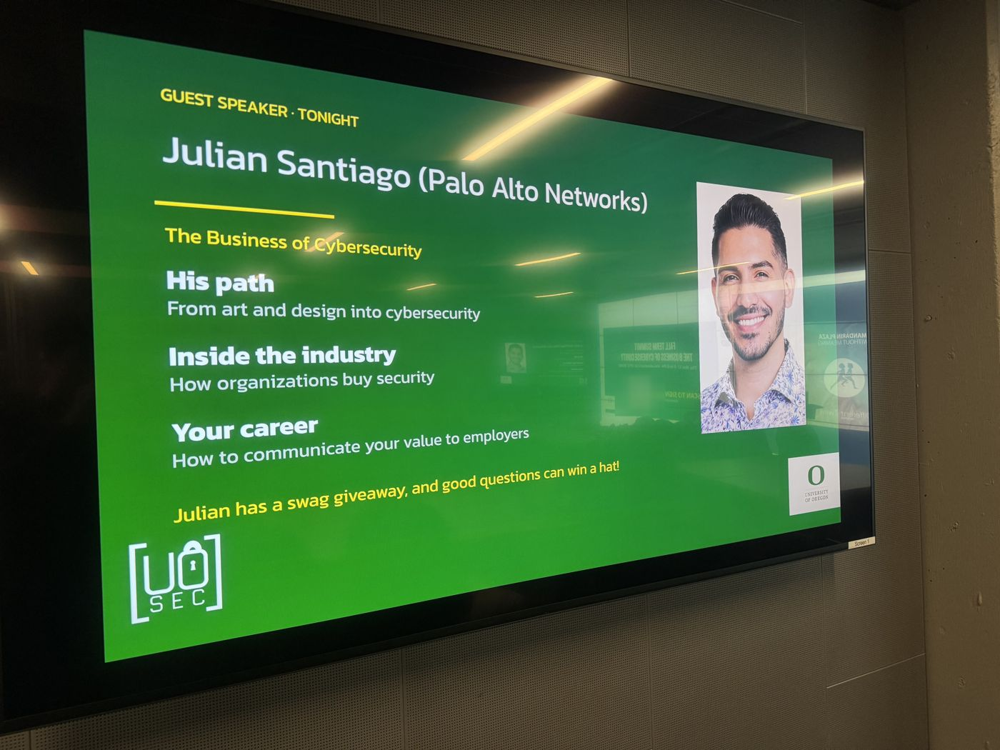
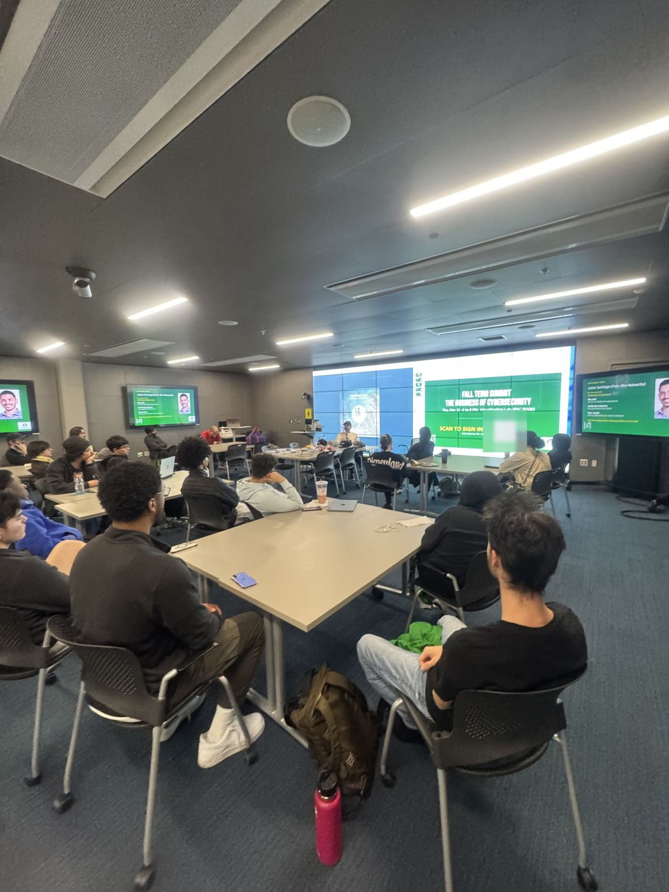

[Julian Santiago](https://www.linkedin.com/in/julianericsantiago/){:target="_blank" rel="noopener"} of Palo Alto Networks joined us in person at the Visualization Lab (PSC B006) for the Fall Term Summit on Thursday, Nov 12. The talk, "The Business of Cybersecurity: How to communicate your value," covered a path from art and design into cyber, how organizations buy security, and how to show employers your value.

It went as planned, if not better. People stayed for two hours, and there was pizza, too.

## Fiduciary partners, not expenses

The biggest takeaway of the night was a shift in how we see ourselves. Students shouldn't think of themselves as a general expense to a company. We should see ourselves as fiduciary partners who add business value. That was the theme of the conversation, and the questions kept coming back to it.

People asked how to find their niche in cybersecurity, how to navigate an industry that is still mostly white and male, and how to communicate risk. All of it tied back to showing the value you bring.

## Where the Summit goes next

We're going to keep building nights like this. This Summit was a pilot built around Julian, and it showed the format can get much bigger. We want people from multiple majors, genders, and ethnicities in the room, networking with faculty and with guests from outside the university. Those guests come from different parts of the industry too, like sales, solutions engineering, post sales, or recruiting.

## More news

- **CWC West.** We're registered for the Cyber Workforce Competition West. The pre-qualifier is 24 hours online, from Sat, Nov 28 at 9:00 AM PT to Sun, Nov 29 at 9:00 AM PT. The top 20 teams go to the finals in San Diego, Feb 16 to 17, 2027. Travel is funded only if we qualify, and it is capped at about 8 to 9 people. The [interest form](https://docs.google.com/forms/d/e/1FAIpQLSe3gDDDwoXF_Yo3u5qlMXJwgeFiAV0KMx88ehXST2wCDqbyqw/viewform){:target="_blank" rel="noopener"} is interest only, not a team spot.
- **Blockchain and cybersecurity.** If you're curious where blockchain and security overlap, we shared an [interest form](https://docs.google.com/forms/d/e/1FAIpQLSd16PjhvuocdMXYLFUS7WrwmJnTQpJ4_8OY2IB1SqIicK6Pow/viewform){:target="_blank" rel="noopener"}. No experience is needed, and it is not a commitment. Fill it out by the end of the day on Friday, Nov 13. The event is [Monad Blitz Oregon](https://luma.com/e8mwhm1s){:target="_blank" rel="noopener"}, Sun, Nov 15, in EMU Ballroom 244, and it has its own separate registration. You'll find that link in the interest form.
- **Meet Mohan Nair.** Mohan Nair, a UO alum and author, is coming through the School of Computer and Data Sciences. The fireside chat, Staying Human in an AI World, is Thu, Nov 19, 4:30 to 6:30 PM in James Commons, Tykeson Hall. To attend, just fill out the [registration form](https://oregon.qualtrics.com/jfe/form/SV_0kxQWQ4MyU3nWMC){:target="_blank" rel="noopener"}. There is also a student lunch on Fri, Nov 20, 11:30 AM to 1:00 PM in Bartolotti's back room at the EMU, with only 3 club spots. [Lunch interest](https://docs.google.com/forms/d/e/1FAIpQLScXmg1y6g6WnIACoERh2sZVXvSra7oRryW1Q0t-Y5mdXfiMjA/viewform){:target="_blank" rel="noopener"} is due by the end of the day on Friday, Nov 13.

## Come join us

Find us in [the club Discord](https://discord.com/invite/wn4T3byxh4){:target="_blank" rel="noopener"} with questions, and keep an eye on the [calendar](https://uosec.org/calendar.html){:target="_blank" rel="noopener"} for what's happening each week.
